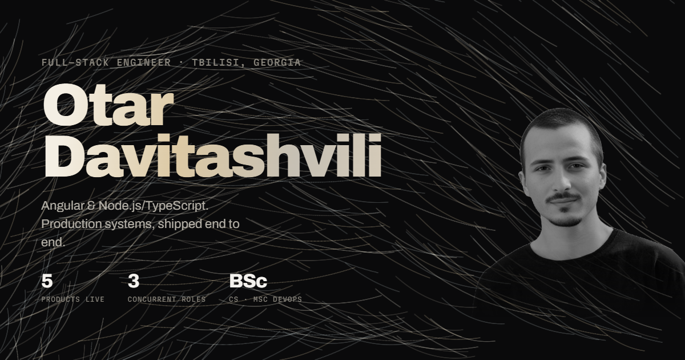

# Portfolio — Otar Davitashvili

My personal portfolio and case-study site, built with **Angular 22 + SSR**.

**🌐 Live:** [portfolio1-1-mu.vercel.app](https://portfolio1-1-mu.vercel.app/)



## Highlights

- **Angular 22, all standalone:** signals, the new `@if` / `@for` / `@defer` control flow, and SSR with hydration through `@angular/ssr`
- **Runs on data:** every project, job, certificate and skill lives in a single typed file (`src/app/data/site-data.ts`), and each case study gets its own route (`/work/:slug`)
- **Performance:** the hero renders before anything else, fonts are subset to Latin, the gallery hydrates only when it scrolls into view, and below-the-fold images load lazily. `scripts/optimize-images.mjs` (sharp) builds the WebP/AVIF images.
- **SEO:** each route has its own meta tags and Open Graph cards, plus a sitemap, robots.txt and redirects for renamed projects
- **Accessibility:** contrast meets AA, the HTML is semantic, and reduced motion is respected
- **CV generator:** `scripts/cv` builds a PDF CV from the same facts the site shows

## Stack

Angular 22 · TypeScript · Tailwind CSS 4 / SCSS · Express (SSR server) · Vercel (hosting, Analytics, Speed Insights)

## Run locally

```bash
npm install
npm start                 # dev server on http://localhost:4200
npm run build             # production build (browser + server)
npm run serve:ssr:Portfolio
```

## Project structure

```
src/app/
  components/   hero, projects, experience, skills, education, certifications, contact
  pages/        home, project-detail (/work/:slug), not-found
  data/         site-data.ts — single source of truth for all content
  interfaces/   typed models for the data
scripts/        image optimisation, CV build, SEO and visual-audit helpers
```

## License

The code is MIT licensed, see [LICENSE](LICENSE). The content (text, photos, CV) is © Otar Davitashvili.
